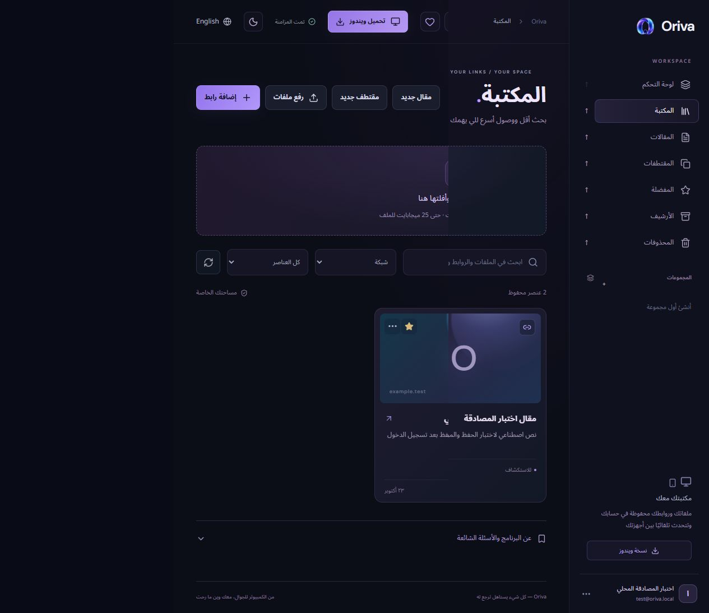

[English](README.md) | [العربية](README.ar.md)

# Oriva

الحصص المعتمدة والتحقق من الاستعادة والبوابات المتبقية: [حالة التخزين والاستعادة](docs/storage-recovery-status.ar.md).

**حالة تنزيل Windows:** لم تتوفر الحزمة المستقرة بعد. أُثبت مانع توافق API ببيانات وهمية معزولة؛ راجع [التحقق من إصدار Windows](docs/windows-release-status.md).

يوضح [قرار النشر والتعافي المحدث](docs/deployment-safety.ar.md) فروق المخطط الدقيقة واختبار احتواء الكتابة وما بقي من شروط التعافي وانتقال العملاء. يتضمن [تحضير ترحيل المجموعات](docs/migration-rollout.ar.md) مقترح نقل محدود قابل للاستئناف وإعادة المحاولة مع فحص ثبات التاريخ؛ لم يُفعّل في الإنتاج.

تصلح [متابعة الاختبار الفعلي](docs/qa-followup.ar.md) استئناف الاستعادة وتعريب أخطائها وتخطيط الخروج العربي في Windows، مع أدلة الواجهة وحدود اختبار المكتبة الكبيرة.

**Oriva 1.0.0 هو اسم الإصدار الرسمي الأول. يحتوي المستودع على التحضير الذي تمت مراجعته؛ لا تعني إتاحة المصدر صدور حزمة Stable أو نشر الإنتاج المطابق قبل اجتياز بوابات الاستعادة والتوافق.** الأرقام 1.5.3 و 1.6.0 تعرّف مراحل تطوير داخلية، وليست إصدارات رسمية عامة سابقة.

Oriva مكتبة رقمية شخصية للروابط والملفات والمقالات ومقتطفات البرمجة والملاحظات التي تساعدك على الرجوع إليها. يحتفظ المشروع بتطبيق Win32 الأصلي وموقع الكمبيوتر والجوال المشترك، دون إنشاء تطبيق أو موقع بديل من الصفر.

[موقع الكمبيوتر](https://oriva.soltairy.chatgpt.site/) · [موقع الجوال](https://oriva.soltairy.chatgpt.site/iphone) · [المستودع](https://github.com/Soiltary/Oriva) · [إصدارات Windows](https://github.com/Soiltary/Oriva/releases)

قد يظل الموقع الحالي على النسخة التاريخية المنشورة. صفحة الإصدارات هي المرجع لحزم Windows الموثّقة مستقبلًا؛ نشر المصدر لا يعني أن حزمة v1.0.0 أصبحت متاحة.

## المزايا وتغطية المنصات

- احفظ الروابط بعناوين وملاحظات ووسوم ومفضلة ومجموعات وحالة قراءة؛ تُحفظ أجزاء العنوان المهمة بعد علامة #.
- ارفع أنواع الملفات المختلفة حتى 25 MiB للملف، ونزّل نسخًا بعد التحقق من ملكية الحساب. يُحفظ ZIP كما هو دون تشغيله أو فكّه تلقائيًا.
- أنشئ مقالات ومقتطفات في محرر الويب مع الحفظ التلقائي والمسودات ومعالجة التعارضات وسجل الإصدارات والمعاينة الآمنة. تُحفظ مسافات الشفرة ومحاذاتها وتتوفر ألوان الصياغة في معاينة الويب.
- نظّم مجموعات الويب بالتداخل والأيقونات والألوان والصور الاختيارية، واختر الشبكة أو القائمة أو العرض المختصر أو اللوحة. تُحفظ تفضيلات لوحة التحكم والشريط الجانبي للحساب.
- استخدم العربية من اليمين لليسار أو الإنجليزية من اليسار لليمين، مع المظهر الداكن أو الفاتح أو إعداد النظام في الويب. يحتفظ Windows بمظهره الأصلي الداكن ونصوصه العربية والإنجليزية.
- زامن بيانات حسابك بين التطبيق الأصلي ومساري الموقع. يستخدم الـ API المحدّث إصدارات مشروطة وصفحات محدودة الحجم.
- صدّر نسخة تطبيق كاملة لحسابك تتضمن الملفات والسجل واستعدها بالإضافة المرحلية. تختلف هذه النسخة عن نسخة مزوّد شاملة لجميع الحسابات للتعافي من الكوارث.

محرر Windows نصّي ويدعم Markdown ؛ لا يوفر معاينة الصور المرئية أو ألوان الصياغة أو التخزين الدائم للمقالات دون اتصال أو إدارة المجموعات المتداخلة كاملةً بصورة مستقلة. لا ندّعي توفر حذف المجموعات أو إعادة ترتيبها أو محرر تقييم كمسارات واجهة مكتملة. التفاصيل في [المزايا](docs/features.ar.md).

## الواجهة الفعلية

الصورة التالية لقطة فعلية من المتصفح باستخدام بيانات اختبار محلية وهمية، وليست صورة حساب إنتاج أو تصميمًا توضيحيًا. لا تثبت اختبار هاتف فعلي أو اكتمال قبول محرر Windows.

التغطية التي تم التحقق منها وحدودها موضّحة في [تقرير الإصدار](docs/release-verification.md).

## تثبيت Windows والبدء لأول مرة

المنصة المستهدفة هي Windows 10/11 بنواة x64. لا يحتاج التطبيق الأصلي إلى محرك متصفح مضمّن أو Python أو.NET. تتطلب عمليات السحابة اتصالًا بالإنترنت. الملف المُجهّز **غير موقّع**؛ يكشف SHA-256 تغيّر البايتات لكنه ليس توثيقًا مستقلًا لهوية الناشر. لا تتجاوز تحذيرات حماية Windows.

ثبّت حزمة رسمية موثّقة فقط بعد ظهورها في صفحة الإصدارات. نزّل ZIP وملف SHA256SUMS.txt ، وتحقق من قيمة SHA-256 الدقيقة، وفك الحزمة كاملة ثم شغّل Setup.cmd المرفق ضمن ملف مستخدم Windows. يضيف المثبّت الحالي الاختصارات وتكامل Explorer الاختياري دون صلاحيات مدير. تصف التعليمات المثبّت المحفوظ؛ لم تُختبر إجراءات التحديث المثبّت أو السجل للمرشح الجديد.

أنشئ حسابًا في الموقع، واحفظ رمز الاستعادة الذي يظهر مرة واحدة في مكان خاص، ثم سجّل الدخول على كل جهاز. جلسات العملاء مستقلة، والمكتبة مشتركة للحساب نفسه. لا تتوفر خدمة تحقق بالبريد أو روابط استعادة مرسلة بالبريد. يتطلب استرداد الحساب رمز الاستعادة الحالي. لا تنشر كلمة مرور حقيقية أو رمز استعادة في بلاغ أو تقرير.

لا تثبّت مرشحًا خاصًا ولا تشغّله بحسابات حقيقية؛ يحتاج إلى الـ API المطابق الذي يتحقق من الإصدارات ولم يُنشر بعد. راجع [التثبيت](docs/installation.ar.md) و[توافق التحديث](docs/update-transition.md).

## المكتبة والمجموعات

استخدم «إضافة رابط» لإدخال العنوان الإلكتروني والعنوان الاختياري وسبب حفظه والوسوم والمجموعة. عدّل البيانات من قائمة العنصر. تحافظ تغييرات المفضلة والأرشفة على الحقول الأخرى، ويرجع الإصدار القديم تعارضًا بدل الكتابة فوق تعديل أحدث. تميّز مراجعة التكرار أجزاء الروابط المهمة. يشمل البحث العناوين والملاحظات والوسوم والروابط والمجموعات بالعربية والإنجليزية.

تنتقل العناصر المحذوفة إلى محذوفات قابلة للاستعادة. تُحتسب ضمن حد 10,000عنصر للحساب، ولا يتوفر تفريغ نهائي للمحذوفات. تحتفظ العناصر المؤرشفة بمجموعاتها، وتستبعد عروض المجموعات النشطة المؤرشف والمحذوف بصورة متسقة. تشمل المفضلة العناصر المؤرشفة المميزة بنجمة. لا تظهر العناصر غير المصنفة داخل مجموعات لا تخصها.

تتوفر خيارات مظهر المجموعات والمجموعة الأم في الويب. جرى التحقق من بعض عمليات اللون والسحب وأدوات الاختيار المخصصة على مستوى API ، وليس عبر كل أداة رسومية أو جهاز. تُحفظ طريقة العرض وإعدادات لوحة التحكم للحساب، بينما تظل اللغة والمظهر تفضيلين محليين لكل جهاز.

## المقالات ومقتطفات البرمجة

يوفر محرر الويب تحميل المستند كاملًا والحفظ التلقائي بعد 900ملّي ثانية والحفظ الصريح وحالة التعديل والحفظ، مع الاحتفاظ بالمسودة عند انقطاع الطلبات ومعاينة السجل واستعادة إصدار سابق. تُعرض روابط Markdown والصور المرفوعة المدعومة بأمان. يظهر HTML المخزّن كنص، وتبقى أنواع الروابط غير الآمنة غير قابلة للتنفيذ. تنسخ الوظيفة متن المستند دون تشغيل الشفرة، وتُحفظ اللغة البرمجية والمسافات والمحاذاة.

حد المستند 1MiB بنص UTF-8، مع حد إضافي لحجم النص المُسلسل كثير المحارف المُهربة. يرفض محرر Windows أكثر من 250,000وحدة UTF-16 بدل بتر المحتوى. تعرض واجهة السجل أحدث 100إصدار سابق، بينما تتضمن نسخة الحساب الكاملة جميع الإصدارات المخزنة. جُرّبت إضافة الصور ومعاينتها الآمنة في حملة اختبارات الويب. حدّت أداة الإدخال من اختبار التراجع والإعادة، لذلك لا ندّعي اجتياز هذا المسار.

## المزامنة والقراءة دون اتصال

تُحدّث المكتبة في العملاء الظاهرين كل 15ثانية تقريبًا وعند العودة للنافذة أو استعادة الاتصال. تقلل الصفحات واستجابات التغيير الجزئي وعدم التغيير وفحوص جيل التحميل نقل البيانات المتكرر واستبدال عرض حديث باستجابة قديمة. تتطلب الكتابة إصدارًا متوقعًا؛ ويبقي تعارض 409 المسودة متاحة. لا تُدمج التعديلات المتزامنة بصمت.

يمكن للمتصفح الاحتفاظ بمكتبة مشفّرة مرتبطة بالمالك وبالنص الكامل لمقالات ومقتطفات فُتحت سابقًا للقراءة دون اتصال. افتح المستند أثناء الاتصال أولًا. لا تُخزّن بايتات الملفات والصور للاستخدام دون اتصال، ولا تُجدول الكتابات غير المحفوظة لإرسال تلقائي لاحق. يمسح الخروج مخابئ الحساب المحلية ويستكمل خروج الخادم عند الاتصال إذا انقطع الطلب. لا يوفر Windows تخزينًا دائمًا للمستندات دون اتصال.

## النسخ الاحتياطي والاستعادة

استخدم لوحة «النسخ الاحتياطي والاستعادة» من قائمة الحساب للحصول على نسخة تطبيق كاملة بدل تنزيل JSON للبيانات الوصفية فقط. احتفظ بالنسخ في مكان خاص؛ تحتوي محتوى المكتبة والمرفقات بنص واضح، لكنها تستبعد بيانات المصادقة. يتحقق التنسيق من قوائم البيان والقطع ويعيد تعيين المعرّفات والمراجع الخاصة المستوردة. تُجهّز الاستعادة السجلات ثم تضيفها مع الاحتفاظ بالموجود، ولا تصفّر الحساب. ينقل التراجع القابل للاستعادة العناصر المستوردة إلى المحذوفات، مع إبقاء المجموعات والإعدادات والكائنات المؤقتة؛ وهو ليس تراجعًا شاملًا للمزوّد.

لا تتضمن نسخة التطبيق كل حسابات الإنتاج أو جداول المصادقة أو إعدادات المزوّد. كذلك لا تثبت نسخ مصدر Sites وجود نسخة استعادة D1/R2. تظل نسخة مزوّد مترابطة واستعادتها في عزل بوابة إصدار مطلوبة. نجحت تجربة محلية اصطناعية للتصدير والتشفير والاستعادة، دون ادعاء وجود نسخة إنتاج. راجع [النسخ والاستعادة](docs/backup-recovery.ar.md).

## تكامل Windows والتحديثات

يدعم التطبيق الأصلي المحفوظ «Save to Oriva» في Explorer وشاشة تسمية وتأكيد قبل الرفع والإخفاء وإعادة الفتح من شريط الإشعارات ونسخة تشغيل واحدة والتنزيل المتدفق بعد المصادقة. قد تظهر عناصر Explorer الكلاسيكية في «إظهار المزيد من الخيارات» في Windows 11. لا يُعاد تسمية الملف الأصلي. تبقي إزالة تكامل القائمة بيانات السحابة. لم يكتمل اختبار المثبّت والسجل وشريط الإشعارات من طرف لطرف للمرشح الجديد، ولم نغيّر تطبيقًا مثبتًا أثناء العمل.

إصدار المنتج العام 1.0.0 منفصل عن رقم توافق المحدّث 2.0.0. يرفض عميل 1.5.3 عرضًا رقميًا مباشرًا للإصدار 1.0.0. يستخدم الانتقال بيانًا متوافقًا قديم التنسيق واسم EXE بديلًا من الموقع نفسه، وبيان v2 يفصل رقم المنتج عن رقم التحديث؛ ويجب أن يشيرا إلى البايتات الموثّقة نفسها. لا تتبع العملاء الحالية تحويلًا إلى GitHub. تبقى متطلبات الحجم و SHA-256 و HTTPS والمسارات الصارمة من الأصل نفسه. اجتازت خوارزمية المقارنة الأصلية اختبارات الانتقال، لكن لم تُجرّب عملية استبدال التطبيق المثبّت وإعادة تشغيله. تبقى بيانات تحديث الإنتاج الحالية دون تغيير ما دامت بوابات الإصدار مفتوحة.

## الجوال و PWA

يستخدم مسار`/iphone` التطبيق وواجهة API نفسيهما بتصميم مخصص للجوال. تتوفر بيانات PWA وأيقونتا 192و 512. يخزّن Service Worker غلاف الموقع وموارده العامة فقط، ويستبعد استجابات API الخاصة وبايتات الملفات. لم تُقبل اختبارات التثبيت على iOS/Android الفعلي وصلاحيات إشعارات النظام ولوحة المفاتيح الافتراضية وانقطاع الشبكة على مستوى النظام. قياس متجاوب في المتصفح ليس اختبار جهاز فعلي.

تعمل فحوص صحة الروابط الاختيارية في المتصفح الأمامي فقط وتتطلب إجراءً أو موافقة داخل التطبيق. تظل نتائج منع CORS والتحويلات والمهل غير حاسمة. لا يوجد ماسح روابط خلفي على الخادم أو مجدول إشعارات دفع.

## البنية التقنية

تطبيق Windows أصلي بلغة C و Win32 ويستخدم WinHTTP و DPAPI وعناصر النظام. الموقع React 19 و TypeScript بمسارات متوافقة مع Next ، ويُبنى باستخدام Vinext/Vite لبيئة Cloudflare Workers. تحفظ D1 الحسابات والبيانات الوصفية والسجل والتفضيلات، وتحفظ R2 بايتات الملفات والصور الخاصة. يشترك مسارا الكمبيوتر و`/iphone` في التطبيق والـ API. تتحقق الكتابات من أصل JSON والملكية والإصدارات المشروطة، ولا يجلب الخادم وجهات الروابط المحفوظة.

راجع [البنية](docs/architecture.md) و[التطوير](docs/development.md) و[إشعارات الطرف الثالث](THIRD_PARTY_NOTICES.md). تستبعد نسخة المصدر العامة هوية Sites الخاصة وإعداداتها وبيانات التشغيل والملفات التنفيذية وآثار الاختبار الداخلية وحزم Staging فقط. ولا تنشر تاريخ Git الخاص بالتطوير.

## التطوير والبناء

استخدم Node 22.13 أو أحدث وأداة pnpm 11.25.0 المثبّتة في إعداد المشروع. احتفظ بقواعد سلسلة التوريد في`pnpm-workspace.yaml` وملف القفل. ثبّت عبر`pnpm install --frozen-lockfile --ignore-scripts`. لا تحتاج الاختبارات الصرفة الموثّقة إلى تشغيل نصوص دورة حياة الحزم. أبقِ الاعتماديات وبيانات التشغيل المحلية خارج Git.

شغّل`node tests/run.mjs` و`node node_modules/typescript/bin/tsc --noEmit --incremental false` و`node scripts/run-framework.mjs build`. أُجريت اختبارات D1/R2 والاستعادة الفعلية بأدوات تحقق محلية خاصة مستبعدة من المصدر العام؛ تتضمن النسخة العامة اختبارات اصطناعية داخل الذاكرة بلا حسابات اختبار حية. لمعاينة المتصفح اضبط موارد محلية معزولة فقط وطبّق الترحيلات محليًا باستخدام`wrangler.local.json` و[أوامر التطوير المحلية](docs/development.md) ؛ لا تحوّلها إلى أوامر بعيدة.

يُبنى المصدر الأصلي باستخدام Zig 0.14.1 ومكتبات نظام Windows ؛ الأوامر في desktop/windows/README.md. اكتب الناتج في مجلد عمل منفصل. لا يمنح بناء إعداد الإنتاج إذن تشغيله بحسابات حقيقية أو تشغيل مثبّته. تختبر برامج الاختبار الصرفة المحلل والمجموعات والتعديلات واللغة والمحدّث دون تثبيت.

## التحقق والحدود المعروفة

يوثق [التحديث الأمني الأخير](docs/native-verification.ar.md) الإصلاح المتحقق: صفر تنبيهات اعتماديات معروفة، وتوليد PNG في Node وWorkers واختبارات منع حقن SVG. نجحت مجموعات الاختبار الـ23. نتائج TypeScript وبناء الويب واختبارات D1/R2 المحلية والمصادقة من المتصفح مسجّلة في تقاريرها السابقة، ولا تثبت صلاحية ترقية الاعتماديات الجديدة أو الإنتاج.

لا تثبت هذه النتائج استعادة الإنتاج أو ترحيله أو قبول تحديث التطبيق المثبّت أو التوقيع أو سلوك هاتف فعلي أو اختبار تحمّل كاملًا بأقصى الأحجام. وصلت مكتبات الاختبار إلى 10,000عنصر؛ أزمنة التجربة المحلية ليست أزمنة الإنتاج. تتضمن الترحيلات المرشحة تعبئة مجموعات قائمة تحتاج تجربة بحجم المزوّد. تبقى سياسة الاحتفاظ بسجلات الاستعادة المؤقتة وسعتها وتنسيق الكتابات القديمة ضمن أعمال الإصدار. راجع [التحقق](docs/release-verification.md) و[خطة الاستعادة](docs/backup-recovery.ar.md) و[سجل التغييرات](CHANGELOG.md).

## حل المشكلات والأمان

ترجع بيانات الدخول الخاطئة 401 والبريد المسجّل 409. تتطلب كثرة المحاولات الانتظار 15دقيقة. احفظ رمز الاستعادة في مكان خاص. يتطلب تعذر الاتصال تشغيل الخدمات والأصل المحليين الصحيحين أو سلامة النشر الرسمي؛ لا تجرب بيانات اعتماد حقيقية على مرشح محلي. ترجع التعديلات القديمة 409؛ راجع الإصدار الأحدث مع الاحتفاظ بمسودتك. يؤدي غياب الإصدار المتوقع إلى 428 للعملاء القديمة، ويجب معالجة الانتقال المنسق قبل نشر الإنتاج.

تُحفظ كلمات المرور كبصمات PBKDF2-SHA256 مملّحة، وتُحفظ رموز الجلسات والاستعادة كبصمات في D1. ملفات تعريف الارتباط في الإنتاج Secure و HttpOnly و SameSite. تستخدم جلسة Windows حماية DPAPI للمستخدم، وتتحقق التنزيلات من الملكية وحدود البايتات. تُراجع تواقيع الصور وتُرفض ملفات SVG. تُعامل الملفات كتنزيلات دون تشغيل. تظل محتويات نسخة التطبيق حساسة رغم استبعاد بيانات المصادقة.

أبلغ عن المشكلات القابلة للإعادة دون كلمات مرور أو نسخ خاصة أو سجلات حقيقية. راجع [الأمان](SECURITY.md) و[حل المشكلات](docs/troubleshooting.ar.md) و[المساهمة](CONTRIBUTING.md). لا تعطّل TLS أو فحص الأصل أو ملكية الجلسة أو بصمات التحديث أو العزل المحلي لاجتياز اختبار.

## الترخيص

شُفرة Oriva الأصلية مرخّصة بموجب [MIT](LICENSE) باختيار مالكها. تحتفظ مكونات الأطراف الثالثة بتراخيصها وإشعاراتها، ولا ندّعي ملكيتها. راجع [إشعارات الطرف الثالث](THIRD_PARTY_NOTICES.md).

تستبعد النسخة العامة أدوات معاينة الموصلات ومحاكاة الهوية المحلية الخاصة، مع الاحتفاظ بمصادقة Oriva وواجهته المشتركة. يمثل مصدر Windows العام فرع الإنتاج، ويرفض علم بناء staging الخاص عند تفعيله بدل الاتصال بالإنتاج تلقائيًا. تبقى قيود أمان staging في نسخة التطوير الخاصة.

أدوات تشغيل المنصة وتجربة D1/R2 الخاصة وآثارها غير منشورة. يضم المصدر العام اختبارات اصطناعية داخل الذاكرة؛ لا يتضمن حسابات اختبار حية أو بيانات اعتمادها. تبقى نتائج التجارب المعزولة وحدودها موثقة.

نجح فحص المتصفح بعد تحديث الاعتماديات أيضًا: تسجيل وهمي جديد، ودخول وخروج، ورسالة كلمة مرور خاطئة بالعربية، واستمرار الجلسة والمحتوى بعد تحديث الصفحة، وحساب مستقل فارغ، وحفظ رابط وتبديل اللغة. تمت العمليات عبر خدمات loopback المعزولة فقط.

أحدث [نتائج Windows وحدود الأمان](docs/native-verification.ar.md).
